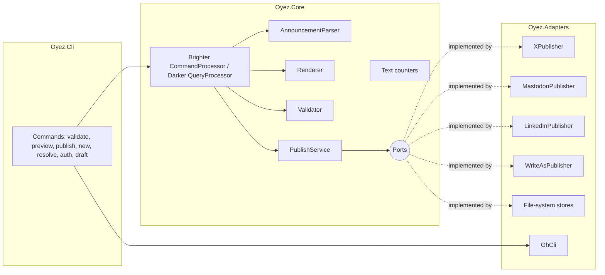
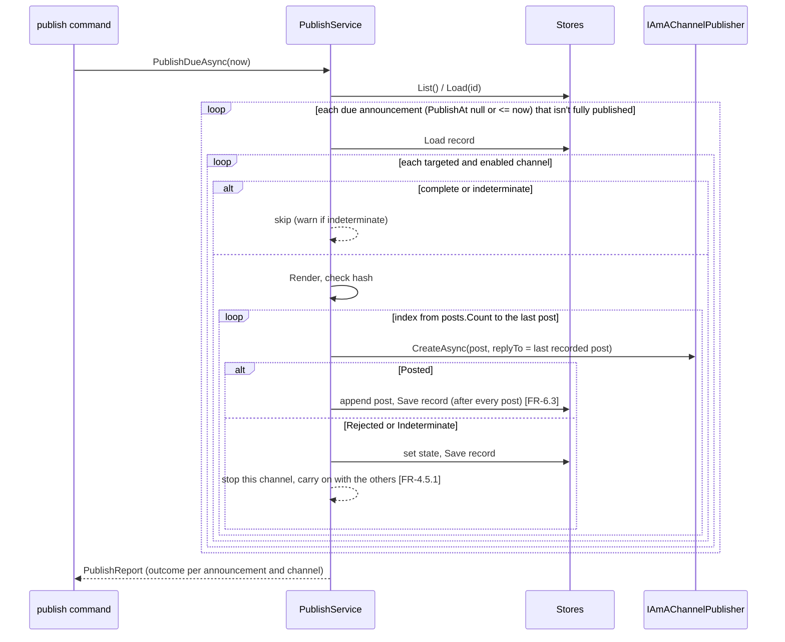

# 1. Oyez's design

Date: 2026-10-23

This ADR is Oyez's design document. It was written as one document before Oyez adopted Brighter's `specs/` layout, so it covers the whole design rather than one decision; later decisions get their own ADRs.

This design implements [`requirements.md`](../../specs/0001-oyez/requirements.md). Requirement IDs (FR-x, NFR-x, AC-x) appear in brackets where a part of the design meets them.

## 1. Overview

Oyez is a .NET 10 console application with a ports-and-adapters structure:

- **Core** holds the domain logic: parsing, counting, rendering, validation and the publishing workflow. It is pure, except for a few ports (interfaces) to the outside world. This is where most of the tests live [NFR-4].
  - Core's **driving ports** are Brighter commands and Darker queries (§4.10). Each command-line verb becomes a command or query, and its handler holds the use-case logic. This makes Oyez a small working example of Brighter and Darker [NFR-3].
- **Adapters** implement Core's other (driven) ports: one HTTP publisher per platform, file-system storage, the GitHub CLI, and the clock.
- **Cli** is the composition root. It parses arguments, sends commands and queries, and prints results.

**Module boundaries.** Each assembly is a narrow, deep module: a small public surface that hides substantial behaviour. Tests only go through that surface (§9). See `CLAUDE.md` for the conventions, which follow Brighter's.

| Module | Public boundary | Internal detail |
|---|---|---|
| `Oyez.Core` | Brighter commands and events, and Darker queries, with their results; the ports (`IAmA…`) and the types in their signatures; `InMemory…` port implementations; configuration types; `AddOyezApplication` | Parsing, text counting, profiles, rendering, validation, cost estimation, the publishing workflow |
| `Oyez.Adapters` | The port implementations (publishers, file stores, `gh`), and `AddOyezAdapters` to register them | HTTP handlers (retry, redaction), OAuth 1.0a signing, JSON shapes |
| `Oyez.Cli` | The command line | Composition, output formatting |

Oyez runs in GitHub Actions for previews on pull requests and for publishing. It runs locally for authentication, previews and debugging [FR-7, intent decision 6].



## 2. Repository layout

```
Oyez.slnx
oyez.json                         # configuration that isn't secret [FR-8.1]
announcements/
  2026-10-20-brighter-10-2-0/     # folder name = announcement ID
    announcement.txt              # header and segments, plain text [FR-1.1–1.3]
    writeas.md                    # optional Markdown body for Write.as [FR-1.4]
    published.json                # publication record, written by Oyez [FR-6.1]
src/
  Oyez.Core/
  Oyez.Adapters/
  Oyez.Cli/
tests/
  Oyez.Core.Tests/
  Oyez.Adapters.Tests/
  Oyez.Cli.Tests/
.github/workflows/
  ci.yml  preview.yml  publish.yml  draft.yml
docs/
```

**One folder per announcement.** This keeps the plain-text segments, the Markdown body and the publication record together. Each file stays in its natural format, as decided in the intent (decision 5). The publication record diffs cleanly in Git.

## 3. Announcement format [FR-1]

`announcement.txt`:

```
title: Brighter 10.2.0 released
publish: 2026-10-20T09:00Z
channels: x, mastodon, linkedin, writeas
---
Brighter 10.2.0 is out! This release adds ... https://github.com/BrighterCommand/Brighter/releases/tag/10.2.0
---
Also in this release: ...
---
Thanks to everyone who contributed ...
```

**Rules**

- The **header** is everything before the first line that is exactly `---`. It holds `key: value` lines. Keys are case-insensitive. Blank lines and lines starting with `#` are ignored. A small parser written for Oyez handles this, so there's no YAML dependency [NFR-3].
  - `title` is required.
  - `publish` is optional. It must be ISO 8601 and include `Z` or a UTC offset, so the time is never ambiguous [AC-2].
  - `channels` is optional. It is a comma-separated list of `x`, `mastodon`, `linkedin` and `writeas`, and it defaults to all four [FR-1.3].
  - An unknown key is a validation error, so typos are caught.
- **Segments** are the blocks between the `---` lines [FR-1.2].
  - Leading and trailing whitespace is trimmed from each segment. Newlines inside a segment are kept.
  - An empty segment is a validation error.
  - Line endings are normalised to `\n`, and text is normalised to Unicode NFC.
- **`writeas.md`**, if present, is the Write.as body [FR-1.4]. If it's absent, Oyez builds the body from the segments, joined by blank lines [FR-1.5].
- **Overrides for one channel** (`x.txt`, `linkedin.txt` and so on) are a Could [FR-1.6]. The design allows for them: the `AnnouncementStore` would read these files and the `Renderer` would use them in place of the segments. They are not in the first release.

**Announcement ID.** The ID is the folder name. It must match `^[a-z0-9][a-z0-9-]*$`. By convention it starts with the date, so announcements sort in order.

## 4. Core domain (`Oyez.Core`)

### 4.1 Model

**Public**, because these types appear in requests, results or port signatures:

```csharp
public sealed record AnnouncementId(string Value);
public readonly record struct ChannelId                         // X, Mastodon, LinkedIn, WriteAs
public sealed record AnnouncementDocument(AnnouncementId Id, string Text, string? WriteAsMarkdown);  // the raw files
public sealed record Post(int Index, string Text, int Count);   // Count is measured by the channel's counter
public sealed record Rendering(ChannelId Channel, string? Title, int? Limit, IReadOnlyList<Post> Posts)
{
    public string Hash { get; }                                 // SHA-256 of the post texts (see §4.8)
}
public sealed record ValidationError(AnnouncementId Announcement, string Message, ChannelId? Channel, int? Segment);
public sealed class Result<T>                                   // a value, or the ValidationErrors that prevented one
```

**Internal**: `Announcement` (the parsed form), `Segment` and `AnnouncementParser`. `AnnouncementParser.Parse(document)` returns `Result<Announcement>`. A `ValidationError` carries the announcement ID, an optional channel, an optional segment number, and a message [NFR-7].

Where a value has domain meaning, it gets its own type rather than a primitive. More such types, such as a character limit, are introduced when behaviour attaches to them.

### 4.2 Text counting [FR-2]

```csharp
internal interface IAmATextCounter { int Count(string text); }
```

**`UrlMatcher`** is shared by the counters. It finds:
1. URLs that start with `http://` or `https://`;
2. bare domains such as `brighter.io` or `asp.net`, for X only. These are tokens of the form `label(.label)+(/path)?`, where the last label is a top-level domain (TLD) on the IANA list. The list is embedded as a resource.

X turns bare domains into links and counts them as 23 characters. If we didn't detect them, we'd undercount any domain shorter than 23 characters.

| Counter | Rules |
|---|---|
| `XTextCounter` | Follows twitter-text configuration v3 [FR-2.1]. NFC-normalise. Replace each URL with 23 units. Split the rest into grapheme clusters (`StringInfo`). A cluster that is an emoji (it contains an `Extended_Pictographic` code point; the ranges are embedded) counts 2. Otherwise each code point counts 1 if it's in X's light ranges (U+0000–U+10FF, U+2000–U+200D, U+2010–U+201F, U+2032–U+2037), and 2 if not. |
| `MastodonTextCounter` | Replace each `http(s)` URL with 23 units. Replace each `@user@domain` mention with `@user`. Then count grapheme clusters [FR-2.2]. |
| `LinkedInTextCounter` | Count UTF-16 code units of the text after preparation (escaping, §4.5). This deliberately overcounts characters outside the Basic Multilingual Plane, so we stay safely under the limit [FR-2.3]. |
| Write.as | Counts UTF-16 code units, for display only. It has no limit by default, and a configured one is shown but never enforced. |

The counters are internal. Their tests are the worked examples from the acceptance criteria (AC-3 and AC-4 for X, AC-5 for Mastodon), observed through the counts that the `PreviewAnnouncement` query reports.

### 4.3 Channel profiles

A **profile** is the pure, platform-specific part of a channel: how to count, the limit, how to render, and how to prepare text. Profiles are internal strategies. Adding a channel means adding a profile, a publisher and a configuration section [NFR-9].

```csharp
internal interface IAmAChannelProfile
{
    ChannelId Id { get; }
    IAmARenderingPolicy Policy { get; }  // ThreadPolicy | SinglePostPolicy | DocumentPolicy
    bool IsEnabled { get; }              // from configuration
    int? Limit { get; }                  // null = no limit
    IAmATextCounter Counter { get; }     // Write.as counts code units, for display only
    string Prepare(string text);         // LinkedIn escapes text; the others return it unchanged
}

internal interface IAmARenderingPolicy
{
    Rendering Render(Announcement announcement, IAmAChannelProfile profile);
    IEnumerable<ValidationError> Errors(Announcement announcement, IAmAChannelProfile profile);
}
```

Each policy renders and also reports the errors particular to its shape (§4.6), so neither the `Renderer` nor the `Validator` branches on the kind of channel. A policy that needs the rendering to find its errors renders it itself. Callers don't reach through to the policy: internal extensions on the profile, `profile.Render(announcement)` and `profile.Errors(announcement)`, hand the profile to its own policy.

| Profile | Policy | Limit (default, from `oyez.json`) |
|---|---|---|
| `XProfile` | Thread | 280 |
| `MastodonProfile` | Thread | 2,263 |
| `LinkedInProfile` | SinglePost | 3,000 |
| `WriteAsProfile` | Document | none (a configured limit is shown, not enforced) |

### 4.4 Rendering [FR-3]

The internal `Renderer` picks the targeted, enabled profiles and renders each with `profile.Render(announcement) → Rendering`, which delegates to the profile's policy; Thread and SinglePost share a `SegmentMerger`. Renderings come out in `ChannelId.All` order. Rendering is pure and deterministic [FR-3.5].

- **Thread and SinglePost.** Merge segments greedily. Start with the first segment as the current post. For each following segment, form `candidate = current + "\n\n" + next`. If `Count(Prepare(candidate)) <= Limit`, the candidate becomes the current post. Otherwise, emit the current post and start a new one with `next` [FR-3.1–3.3].
  - X needs no special case [FR-3.4]. Segments are written close to 280 characters, so joining two almost always goes over the limit and each becomes its own post. If two short segments do fit together, they're merged, which saves a post. AC-8 uses segments of about 250 characters, so it gets one post per segment.
- **SinglePost.** If the result has more than one post, the policy reports a LinkedIn overflow [FR-4.3.2, AC-9].
- **Document.** One post. The title is the announcement's title, and the text is `WriteAsMarkdown` or, failing that, the segments joined by blank lines [FR-1.5].

### 4.5 LinkedIn preparation [FR-4.3.3]

LinkedIn's Posts API treats commentary as "little text format". `LinkedInProfile.Prepare`:

1. converts `#word` into LinkedIn's hashtag template `{hashtag|\#|word}`, so hashtags stay clickable. You can turn this off with `linkedin.convertHashtags`;
2. escapes the reserved characters `\ | { } @ [ ] ( ) < > # * _ ~` with a backslash, except inside the hashtag templates created in step 1.

The text is counted after preparation [AC-10].

### 4.6 Validation [FR-5.2]

`Validator.Validate(Announcement) → IReadOnlyList<ValidationError>` (internal). It runs only when the announcement parsed; each targeted profile's policy reports the errors particular to its shape.

- **Header errors** come from the parser: a missing title, a bad or zoneless time, an unknown channel or key, a key that appears twice, a line with no colon, an empty `channels:` value, no segments, an empty segment, or an ID that isn't a valid folder name.
- **Nowhere to publish:** at least one targeted channel must be enabled in configuration.
- **Segment check:** for each targeted Thread or SinglePost channel, every segment must fit the channel's limit, counted on the prepared text. X is checked even when it isn't targeted or is disabled, because segments are always written to the strictest limit [AC-6]. The validator checks X's profile alongside the targeted ones, de-duplicated by channel, so X is reported once by construction. Document channels have no segment check, so a configured Write.as limit is never enforced.
- **SinglePost check:** for each targeted channel with this policy, the rendering must have exactly one post.
- **Document check:** a Write.as rendering must have a body that isn't empty. (A missing title is already a header error.)

Preview fails only on header errors, so an announcement that is over a limit can still be previewed and fixed.

### 4.7 Ports

The ports are public. Each has an `InMemory…` implementation in `Oyez.Core`, used by the tests and usable in production.

The announcement store only reads and lists the raw files. Parsing them is domain logic, so it stays inside Core.

```csharp
public interface IAmAnAnnouncementStore
{
    IReadOnlyList<AnnouncementId> List();
    AnnouncementDocument? Load(AnnouncementId id);      // null if there is no such announcement
}

public interface IAmAPublicationRecordStore
{
    PublicationRecord Load(AnnouncementId id);    // returns an empty record if none exists
    void Save(AnnouncementId id, PublicationRecord record);
}

public interface IAmAChannelPublisher
{
    ChannelId Channel { get; }
    bool CreateIsIdempotent { get; }              // true when the platform honours an idempotency key
    Task<PostResult> CreateAsync(PostRequest request, CancellationToken ct);
    Task<CredentialStatus> VerifyAsync(CancellationToken ct);   // read-only call, for `oyez check`
}

public sealed record PostRequest(
    AnnouncementId Announcement, Rendering Rendering, int Index,
    PostRef? ReplyTo, string IdempotencyKey);

public sealed record PostRef(string Id, string? Url);

public sealed record CredentialStatus(bool IsValid, string Message, DateTimeOffset? ExpiresAt = null);

public abstract record PostResult
{
    public sealed record Posted(PostRef Ref) : PostResult;
    public sealed record Rejected(string Reason) : PostResult;       // definitely not posted
    public sealed record Indeterminate(string Reason) : PostResult;  // may have been posted
}
```

`TimeProvider` (from the BCL) supplies the clock. `AddOyezApplication` registers `TimeProvider.System` unless the host has registered one; tests use `FakeTimeProvider` [AC-17].

`InMemoryChannelPublisher` posts every request and records it. A test can make it answer differently from a given post onward with `RespondFrom(index, PostResult)`, set its `VerifyAsync` answer with `ReportCredentials`, and go back to posting with `RespondNormally()`.

### 4.8 Publication record [FR-6]

`published.json`:

```json
{
  "channels": {
    "x": {
      "state": "complete",
      "renderingHash": "sha256:…",
      "posts": [
        { "index": 0, "id": "1847…", "url": "https://x.com/ICooper/status/1847…", "at": "2026-10-20T09:07:12Z" }
      ]
    },
    "linkedin": { "state": "indeterminate", "reason": "Timed out creating post 1", "renderingHash": "sha256:…", "posts": [] }
  }
}
```

The `state` for each channel is one of:
- `partial` — some posts were made;
- `complete`;
- `indeterminate` — an attempt may or may not have succeeded;
- `failed` — the last attempt was definitely rejected. The next run retries a failed channel.

**Rendering hash.** `Rendering.Hash` is a `RenderingHash` value: `sha256:` followed by the hex SHA-256 of the rendering's post texts, which is how it's stored. If a channel has recorded posts (it is `partial`, or `failed` part-way) and the current rendering's hash differs from the recorded one, someone edited the announcement after it was partly published. Resuming could post the wrong continuation, so the channel fails with a message telling you to resolve it [FR-6.2, NFR-7].

**Indeterminate state.** The workflow runs every hour, so retrying an uncertain create automatically risks a duplicate post every hour. Instead, an `indeterminate` channel is skipped on later runs, with a warning, until someone runs `oyez resolve` (§6). This refines NFR-6 to cover runs after the first.

### 4.9 PublishService [FR-4.5, FR-6, FR-7.1]



**Rules**

- Channels run one after another. The volume is tiny, and running them in sequence keeps logs and record writes simple.
- A channel whose secrets are missing is reported as `Rejected("missing secret OYEZ_…")`. This doesn't stop the other channels.
- A thread reply always goes to the last *recorded* post. This makes resuming exact [AC-15].
- The idempotency key is `oyez:{announcementId}:{channel}:{index}:{fingerprint}`, where the fingerprint is the first 12 hex digits of the rendering hash, after `sha256:`.
- `PublishReport` lists an outcome for each channel attempted or skipped, with its state, its reason (for `failed` and `indeterminate`, the warning) and the posts this run made. Its `JobSummary` is the Markdown for the job summary [NFR-10], and the CLI sets the exit code from the outcomes [FR-4.5.2].
- `PublishService` chooses the due, valid announcements. For each targeted channel, an internal `ChannelRun` makes the skip decision (complete, or indeterminate with a warning), the edited check and the post loop, saves the record after each post, and raises the event that the post's result implies.

### 4.10 Application layer: Brighter commands and Darker queries

Each use case is a request sent through Brighter's `CommandProcessor` (for a command, which changes state) or Darker's `QueryProcessor` (for a query, which reads state). This is the command–query separation Brighter and Darker were built for. The CLI only parses arguments, sends one request and prints the result. Each handler can be tested without the CLI.

All requests are handled in-process, so no message transport, outbox or service activator is needed. Only the core `Paramore.Brighter` and `Paramore.Darker` packages and their DI integration are used.

**Commands**

These are Brighter `Command` subclasses, each with its own `RequestHandlerAsync<T>`.

| Command | Handler does | Result |
|---|---|---|
| `PublishDueAnnouncements` | Runs `PublishService` (§4.9). "Now" comes from `TimeProvider`, so the command carries no time. | `PublishReport` |
| `ResolveChannel(Announcement, Channel, Posted?)` | Updates an `indeterminate` channel in the record: with a `PostRef`, the post was made, so it becomes `partial` or, for the last post, `complete`; without one, `failed`, so the next run retries it [FR-6.6]. | `Result<ChannelState>`: the new state, or a `ValidationError` if the channel isn't indeterminate |
| `CreateAnnouncement(Slug, PublishAt?)` | Creates the folder from a template. | path |
| `DraftFromRelease(Repo, Tag)` | Phase 2 [FR-7.4]. | path |
| `AuthorizeLinkedIn` | Runs the flow in §6. | — |
| `AuthorizeWriteAs(User, Password)` | Logs in and stores the token. | — |

A Brighter command returns nothing. A handler that produces a result writes it to a `Result` property on the command, and the CLI reads it after `SendAsync` returns. That is the usual Brighter idiom for in-process commands.

**Queries**

These are Darker `IQuery<TResult>` types, each with a `QueryHandlerAsync<TQuery, TResult>`.

| Query | Result |
|---|---|
| `ValidateAnnouncements(Ids?)` | `IReadOnlyList<ValidationError>` [FR-5.2] |
| `PreviewAnnouncement(Id, Channel?)` | `Preview`: the renderings with counts, limits and the estimated X cost [FR-5.1, FR-5.3] |
| `GetPublicationStatus(Id)` | The announcement's `PublicationRecord`: each channel's state, posts and reason |
| `CheckCredentials` | A `CredentialsReport`: each enabled channel's credential status (calls each publisher's read-only `VerifyAsync`), with the days left when a token expires within 14 days [FR-4.3.5] |

**Events**

`PublishService` publishes these in-process with `CommandProcessor.PublishAsync`:
- `PostPublished(Announcement, Channel, Index, Post)`
- `ChannelPublishFailed(Announcement, Channel, State, Reason)`, for a channel that is now `failed` or `indeterminate`

Brighter's `Command` and `Event` already have an `Id`, so the requests here name the announcement `Announcement`.

The job summary is built from the `PublishReport`, not by event handlers, so the events have no handler in Core yet; a logging handler can subscribe without changing `PublishService`.

The publication record is **not** saved by an event handler. `PublishService` saves it directly, before it publishes the event. That keeps the guarantee in FR-6.3 clear and independent of handler ordering.

**Handler pipeline**

Handlers use Brighter's `[RequestLogging]` attribute (and Darker's `[QueryLogging]`) for consistent tracing. Retries on HTTP calls stay in the `HttpClient` pipeline (§5.1), not in a Brighter policy. That's because the decision whether a retry is safe depends on whether a given HTTP request was sent and on whether the platform supports idempotent creates, which only the HTTP layer can see.

**Registration**

In the composition root, Brighter and Darker each scan `Oyez.Core` for their handlers.

## 5. Adapters (`Oyez.Adapters`)

### 5.1 HTTP pipeline [NFR-5, NFR-6]

Each publisher is a typed `HttpClient` registered through `IHttpClientFactory`, by `AddOyezAdapters`. Two internal handlers are written for Oyez, so Polly isn't needed [NFR-3]. Their behaviour is tested through the publishers:

1. **`RetryHandler`.** It reads a per-request option, `Oyez.Idempotent` (`HttpRequestOptionsKey<bool>`):
   - **Idempotent requests** (GETs, Mastodon creates with an `Idempotency-Key`): up to 3 retries on 5xx responses, timeouts and `HttpRequestException`, with backoff of 1, 2 and 4 seconds.
   - **Non-idempotent creates** (X, LinkedIn and Write.as): retry only when it's certain the request had no effect. That means a 429 response, or a connection failure before the request was sent (`SocketError.ConnectionRefused` or `HostNotFound`). A 5xx response or a timeout returns an `Indeterminate` result to the publisher [AC-20].
   - **On 429:** wait for `Retry-After` if it's 60 seconds or less. Otherwise give up, and the publisher returns `Rejected`.
2. **`RedactingLoggingHandler`.** Logs the method, host, path and status. It never logs headers or bodies. On a 4xx response, it logs the error body after redaction.

In addition, `SecretRedactor` holds every secret value loaded at startup. The console logger's formatter applies it to every message, as a second safeguard [AC-19]. GitHub Actions also masks secrets in its logs.

### 5.2 X publisher [FR-4.1]

- `POST https://api.x.com/2/tweets` with body `{"text": "…", "reply": {"in_reply_to_tweet_id": "…"}}`.
- **Authentication: OAuth 1.0a user context.** Its tokens don't expire, which suits unattended runs in GitHub Actions [FR-4.1.2]. OAuth 2.0 with PKCE was rejected: its tokens expire after 2 hours and its refresh tokens rotate, so every run would need to write secrets back.
- An `OAuth1Signer` written for Oyez (HMAC-SHA1) does the signing. The JSON body isn't part of the signature base string. It's tested against X's published example signature.
- The four secrets are the consumer key and secret and the access token and secret for `@ICooper`. They are generated in the X Developer Console, so no sign-in command is needed.
- **Response:** `data.id`. The post URL is `https://x.com/ICooper/status/{id}`. The handle comes from configuration.

### 5.3 Mastodon publisher [FR-4.2]

- `POST {instance}/api/v1/statuses` with `status`, `visibility=public` and optionally `in_reply_to_id`.
- Authentication: `Authorization: Bearer {token}`. The token comes from an application created in hachyderm.io's settings, with only the `write:statuses` scope, plus `read:accounts` for `oyez check`.
- Sends an `Idempotency-Key` header, which Mastodon honours for an hour. So `CreateIsIdempotent = true` and creates are retried safely.
- **Response:** `id` and `url`.

### 5.4 LinkedIn publisher [FR-4.3]

- `POST https://api.linkedin.com/rest/posts`, with these headers:
  - `Authorization: Bearer …`
  - `LinkedIn-Version: {yyyyMM}` (from configuration; LinkedIn retires versions after about a year, so the docs explain how to bump it)
  - `X-Restli-Protocol-Version: 2.0.0`
- **Body:**

  ```json
  {
    "author": "urn:li:person:{id}",
    "commentary": "<prepared text>",
    "visibility": "PUBLIC",
    "distribution": { "feedDistribution": "MAIN_FEED", "targetEntities": [], "thirdPartyDistributionChannels": [] },
    "lifecycleState": "PUBLISHED",
    "isReshareDisabledByAuthor": false
  }
  ```
- **Response:** 201, with the `x-restli-id` header holding `urn:li:share:…`. The post URL is `https://www.linkedin.com/feed/update/{urn}`.
- The access token and the person URN come from `oyez auth linkedin` (§6). The token's expiry is stored as a GitHub Actions *variable* (`OYEZ_LINKEDIN_TOKEN_EXPIRES_AT`), so the workflow can read it. The publisher warns when the token expires within 14 days. It returns `Rejected("LinkedIn token expired on …; run oyez auth linkedin")` once the token has expired [FR-4.3.5].
- **Known limitation:** posting a URL through the API doesn't produce a link-preview card. It needs an attached article and image to do that, which is out of scope because media is out of scope.

### 5.5 Write.as publisher [FR-4.4]

- `POST https://write.as/api/collections/{alias}/posts` with body `{"title": …, "body": …}`, and the header `Authorization: Token {token}`.
- **Response:** `data.id` and `data.slug`. The post URL is `https://ian-cooper.writeas.com/{slug}`, with the base URL taken from configuration.

### 5.6 File-system stores

- **`FileSystemAnnouncementStore`** reads `announcements/*/announcement.txt` and the optional `writeas.md`.
- **`FileSystemPublicationRecordStore`** writes `published.json` atomically: it writes a temporary file and then renames it. Its JSON is camelCase and indented, for clean diffs.
- Both take a root path, so tests use temporary folders. That means no extra dependency for abstracting the file system.
- **`FileSystemAnnouncementStore`** returns the raw `AnnouncementDocument`. It doesn't parse.

### 5.7 GitHub CLI adapter

`IAmAGitHubSecretStore` (implemented as `GhCli`) runs `gh secret set NAME` and `gh variable set NAME`. It passes the secret value on standard input, never as an argument, so it can't leak into process listings. Tests use a fake.

## 6. Command-line interface (`Oyez.Cli`)

The CLI is built on `System.CommandLine` 2.x. `Program.cs` is the composition root, using `Microsoft.Extensions.DependencyInjection`, `Microsoft.Extensions.Configuration` and `Microsoft.Extensions.Logging`. Each verb sends exactly one Brighter command or Darker query (§4.10) and formats the result.

| Command | Purpose | Requirements |
|---|---|---|
| `oyez new <slug> [--publish <time>]` | Creates a dated announcement folder from a template. | NFR-8 |
| `oyez validate [<id>…]` | Validates the named announcements, or all of them. Exit code 2 on errors. | FR-5.2 |
| `oyez preview <id> [--channel c] [--format text\|markdown]` | Shows each channel's rendering, with counts and limits and the estimated X cost. Makes no HTTP calls. | FR-5.1, FR-5.3, AC-18 |
| `oyez publish [<id>] [--now <time>]` | Publishes due announcements, or one named announcement. `--now` overrides the clock for testing. | FR-7.1 |
| `oyez status [<id>]` | Shows the publication record for each channel. | NFR-7 |
| `oyez check` | Checks each enabled channel's credentials with a read-only call: X `GET /2/users/me`, Mastodon `verify_credentials`, LinkedIn `userinfo` and Write.as `/api/me`. Also reports LinkedIn token expiry. This lets us test setup without posting. | FR-4.3.5, NFR-7 |
| `oyez resolve <id> <channel> (--posted <postId> [--url <url>] \| --not-posted)` | Clears an `indeterminate` state after you've checked the platform by hand. | §4.8 |
| `oyez auth linkedin` | Runs the browser OAuth flow and updates the GitHub secret and variables. | FR-4.3.4, AC-22 |
| `oyez auth writeas` | Logs in with a username and password, and stores the token as a GitHub secret. | FR-4.4.2 |
| `oyez draft --repo <owner/name> --tag <tag>` | Drafts an announcement from a GitHub release. | FR-7.4 (phase 2) |

**Exit codes:** 0 success, 1 failure on at least one channel, 2 validation errors, 3 configuration error.

**Estimated X cost** [FR-5.3]: for each post, $0.20 if it contains a URL (using the same `UrlMatcher`), otherwise $0.015. The prices live in `oyez.json`, because X changes them.

**`auth linkedin` flow**
1. Read `OYEZ_LINKEDIN_CLIENT_ID` and `OYEZ_LINKEDIN_CLIENT_SECRET` from .NET user secrets, which are kept locally only.
2. Start an `HttpListener` on `http://localhost:8765/callback`. This redirect URL is registered in the LinkedIn app.
3. Open the browser at the authorisation URL, with `scope=openid profile w_member_social` and a random `state` value.
4. Exchange the returned code at `/oauth/v2/accessToken`, then call `/v2/userinfo` to get the `sub`, which forms the person URN.
5. Store the results in GitHub Actions: `gh secret set OYEZ_LINKEDIN_ACCESS_TOKEN`, then `gh variable set` for `OYEZ_LINKEDIN_PERSON_URN` and `OYEZ_LINKEDIN_TOKEN_EXPIRES_AT`.

## 7. Configuration and secrets [FR-8]

`oyez.json`, committed to the repository:

```json
{
  "announcementsPath": "announcements",
  "x":        { "enabled": true, "limit": 280,  "handle": "ICooper", "apiBase": "https://api.x.com",
                "pricing": { "post": 0.015, "postWithUrl": 0.20 } },
  "mastodon": { "enabled": true, "limit": 2263, "instance": "https://hachyderm.io" },
  "linkedin": { "enabled": true, "limit": 3000, "apiBase": "https://api.linkedin.com",
                "apiVersion": "202609", "convertHashtags": true },
  "writeas":  { "enabled": true, "collection": "ian-cooper", "apiBase": "https://write.as/api",
                "blogUrl": "https://ian-cooper.writeas.com" }
}
```

Each `apiBase` setting lets the integration tests in `Oyez.Cli.Tests` point Oyez at fake servers.

**Secrets and variables**

Secrets are read from environment variables only. Locally, they can also come from .NET user secrets [FR-8.2].

| Name | Kind | Used by |
|---|---|---|
| `OYEZ_X_CONSUMER_KEY`, `OYEZ_X_CONSUMER_SECRET`, `OYEZ_X_ACCESS_TOKEN`, `OYEZ_X_ACCESS_TOKEN_SECRET` | secret | X |
| `OYEZ_MASTODON_ACCESS_TOKEN` | secret | Mastodon |
| `OYEZ_LINKEDIN_ACCESS_TOKEN` | secret | LinkedIn |
| `OYEZ_LINKEDIN_PERSON_URN`, `OYEZ_LINKEDIN_TOKEN_EXPIRES_AT` | variable | LinkedIn |
| `OYEZ_WRITEAS_ACCESS_TOKEN` | secret | Write.as |
| `OYEZ_LINKEDIN_CLIENT_ID`, `OYEZ_LINKEDIN_CLIENT_SECRET` | local user secrets only | `auth linkedin` |

## 8. GitHub Actions [FR-7, NFR-5]

All third-party actions are pinned to commit SHAs, with the version in a comment. Dependabot keeps them up to date. Each workflow declares `permissions` explicitly.

| Workflow | Triggers | What it does | Permissions |
|---|---|---|---|
| `ci.yml` | `pull_request`, `push` to `main` | `dotnet build`, `dotnet test` | `contents: read` |
| `preview.yml` | `pull_request` on `announcements/**` | `oyez validate` on the changed announcements; `oyez preview --format markdown`; then posts the preview as a PR comment, or updates the existing one, using `gh pr comment --edit-last` [FR-5.4] | `contents: read`, `pull-requests: write` |
| `publish.yml` | `push` to `main` on `announcements/**`; `schedule: '17 * * * *'`; `workflow_dispatch` | `oyez publish`, writing a report to `$GITHUB_STEP_SUMMARY` [NFR-10]. A final step with `if: always()` commits any changed `published.json` files with `[skip ci]`, then runs `git pull --rebase` and pushes [FR-6.4] | `contents: write` |
| `draft.yml` (phase 2) | daily `schedule`, `workflow_dispatch` (repo and tag) | See below | `contents: write`, `pull-requests: write` |

**`publish.yml` details**
- It uses `concurrency: { group: publish, cancel-in-progress: false }` [FR-7.3].
- The cron runs at minute 17 rather than on the hour, because GitHub Actions delays jobs scheduled on the hour.
- **Cost of the hourly cron.** The repository is public, so GitHub Actions minutes are free. NuGet caching keeps each run short anyway.

**`draft.yml` details (phase 2) [FR-7.4–7.5]**
- **Polling rather than `repository_dispatch`.** The workflow polls the configured BrighterCommand repositories for new releases, using the GitHub releases API with the default `GITHUB_TOKEN`, which can read public repositories. The `repository_dispatch` approach in FR-7.5 would need a personal access token stored in the BrighterCommand repositories; polling avoids that.
- **Recording what's been seen.** Releases already drafted are recorded in `announcements/.drafted.json`.
- **What it produces.** For each new release, `oyez draft` creates a folder:
  - `announcement.txt` gets a first segment with the release name and URL, plus placeholder segments.
  - `writeas.md` gets the full release notes.
- **Opening the PR.** Oyez opens a PR with `gh pr create`.
- **Gotcha.** A PR created with `GITHUB_TOKEN` doesn't trigger other workflows, so `preview.yml` won't run. `draft.yml` therefore runs `oyez preview` itself and puts the output in the PR body.

**The end-to-end flow**
1. A release is published.
2. A draft PR appears, or you run `oyez new`.
3. You edit the segments.
4. The PR preview shows the rendering for each channel.
5. You merge the PR.
6. `publish.yml` posts it, or the hourly cron does once the `publish` time arrives.

## 9. Testing strategy [NFR-4]

Tests follow Brighter's conventions (see `CLAUDE.md`):
- They're written first, and each test is approved before it's implemented.
- They're named `When_…_should_…`, one per file, with Arrange/Act/Assert sections.
- They go only through each module's public boundary (§1). No test names an internal type.

**Tools**

- xUnit v3, with the built-in `Assert` (no assertion library is needed).
- `Microsoft.Extensions.TimeProvider.Testing` for the clock.
- `InMemory…` port implementations in `Oyez.Core`, in place of I/O.
- A `FakeHttpMessageHandler`, written for Oyez, that records requests and returns scripted responses for each route. It's a test double for I/O only.

**Test levels**

| Level | Project | How it reaches the behaviour |
|---|---|---|
| Core | `Oyez.Core.Tests` | Sends commands and runs queries through the real Brighter and Darker processors, built by `AddOyezApplication`, with `InMemory…` stores, in-memory publishers standing in for the platforms, and `FakeTimeProvider`. Parsing, counting, rendering and validation are observed through the `PreviewAnnouncement` and `ValidateAnnouncements` queries. Publishing is observed through `PublishDueAnnouncements`. This is the bulk of the acceptance criteria: AC-1–10 and AC-15–17. |
| Adapter | `Oyez.Adapters.Tests` | Calls each port implementation, registered by `AddOyezAdapters`, against `FakeHttpMessageHandler`, temporary folders or a fake process runner. Checks the request shape and headers, the mapping of responses to `Posted`, `Rejected` or `Indeterminate`, the retry rules and redaction, and X's OAuth signature. The signature test uses X's published example, with a fixed clock and a fixed nonce injected through public seams. AC-11–13, AC-20. |
| End-to-end | `Oyez.Cli.Tests` | The whole CLI, run in-process against a temporary repository and fake HTTP handlers registered through DI. Covers exit codes, the job summary, preview output and log redaction. AC-14, AC-18, AC-19. |
| Review | — | A checklist for the workflow YAML (AC-21, first part). `actionlint` runs in CI. |
| Manual | — | The first real announcement exercises all four channels (AC-21, second part). The LinkedIn sign-in is AC-22. To smoke-test one channel at a time, use `channels:` in an announcement. |

**Contract drift.** The fake HTTP responses are based on each platform's documented examples, and those examples are stored under `tests/…/Fixtures/`. If a platform changes its API, the manual run catches it. Updating the fixture then reproduces the change in tests.

## 10. Dependencies [NFR-3]

**Runtime**
- `Paramore.Brighter` and `Paramore.Brighter.Extensions.DependencyInjection` (10.8.x; in-process command processor only)
- `Paramore.Darker`, `Paramore.Darker.AspNetCore` (Darker's DI registration; despite its name it depends only on `Microsoft.Extensions.DependencyInjection`) and `Paramore.Darker.QueryLogging` (4.1.x)
- `System.CommandLine`
- `Microsoft.Extensions.DependencyInjection`
- `Microsoft.Extensions.Configuration.Json`
- `Microsoft.Extensions.Configuration.EnvironmentVariables`
- `Microsoft.Extensions.Configuration.UserSecrets`
- `Microsoft.Extensions.Http`
- `Microsoft.Extensions.Logging.Console`

**Tests**
- `xunit.v3`, run on Microsoft Testing Platform (opted into in `global.json`), so `Microsoft.NET.Test.Sdk` isn't needed
- `Microsoft.Extensions.TimeProvider.Testing`

Versions were checked on NuGet on 2026-10-22 and are pinned with central package management in task T-0.

There are no SDKs for individual platforms and no YAML parser. Polly isn't used directly, although Brighter may bring it in as a transitive dependency.

## 11. Alternatives considered

| Option | Decision |
|---|---|
| A single file for each announcement, with the Markdown embedded | Rejected. Mixing plain text and Markdown in one file needs a second delimiter. A folder also gives the publication record a natural home. |
| Plain service classes called directly from the CLI | Rejected in favour of Brighter and Darker (§4.10). Using them costs a few dependencies, but makes Oyez a working example of both libraries and gives every use case the same handler shape. |
| Brighter policies (`[UseResiliencePipeline]`) for HTTP retries | Rejected. Deciding whether a retry is safe needs facts about each HTTP request (§5.1), so retries stay in the `HttpClient` pipeline. |
| Platform SDKs (such as LinqToTwitter or Mastonet) | Rejected. Each platform needs only one endpoint, and SDKs lag behind API changes, such as X's move to pay-per-use. |
| OAuth 2.0 with PKCE for X | Rejected. Its tokens expire after 2 hours and its refresh tokens rotate, which doesn't suit unattended runs. |
| Retrying uncertain creates automatically | Rejected. A duplicate public post is worse than a delayed one. Uncertain creates go to `indeterminate` and wait for `oyez resolve`. |
| `repository_dispatch` from the BrighterCommand repositories | Deferred in favour of polling, which needs no cross-repository token. |

## 12. Traceability

| Requirement | Design section |
|---|---|
| FR-1 | §3, §4.1, §5.6 |
| FR-2 | §4.2 |
| FR-3 | §4.4 |
| FR-4.1 | §5.2 |
| FR-4.2 | §5.3 |
| FR-4.3 | §4.5, §5.4, §6 (`auth linkedin`) |
| FR-4.4 | §5.5, §6 (`auth writeas`) |
| FR-4.5 | §4.9 |
| FR-5 | §4.6, §6 (`validate`, `preview`), §8 (`preview.yml`) |
| FR-6 | §4.8, §4.9, §4.10 (`ResolveChannel`), §8 (`publish.yml`) |
| FR-7 | §4.9, §8 |
| FR-8 | §7 |
| NFR-1 | §5.2 (pricing), §8 (cron minutes) |
| NFR-2 | §1, §10 |
| NFR-3 | §4.10, §5.1, §10 |
| NFR-4 | §9 |
| NFR-5 | §5.1, §5.7, §8 |
| NFR-6 | §4.8, §5.1 |
| NFR-7 | §4.1, §4.8, §6 |
| NFR-8 | §6 (`new`), §8 (`draft.yml`) |
| NFR-9 | §4.3 |
| NFR-10 | §4.9, §8 |
